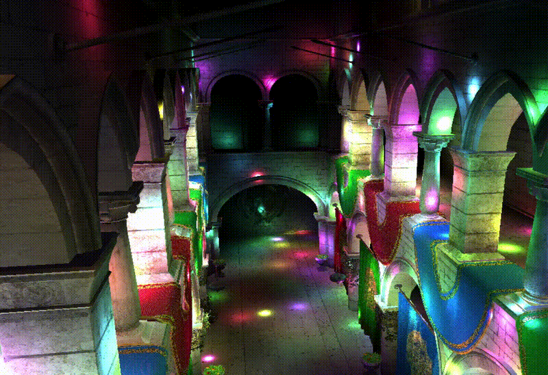
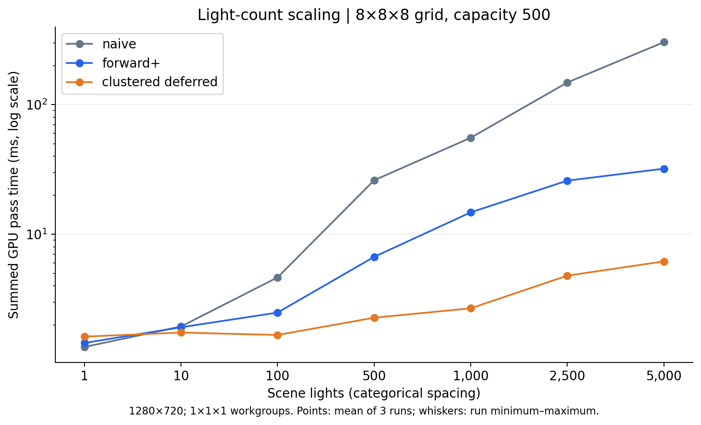
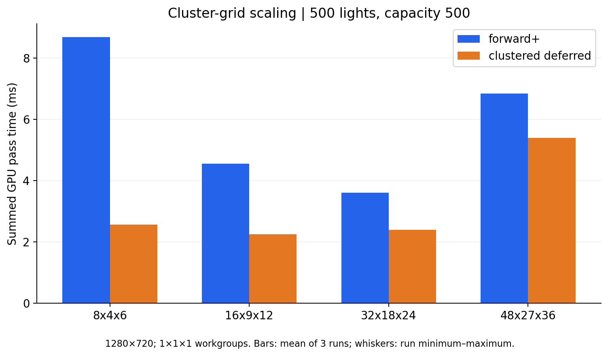
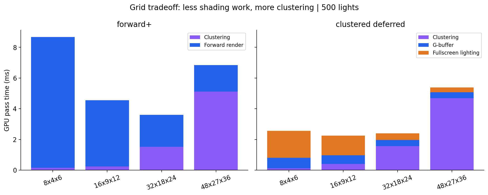
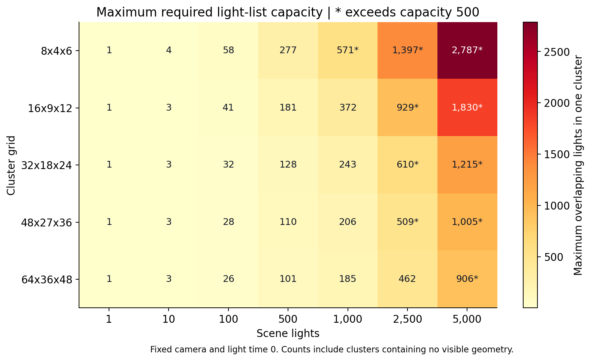
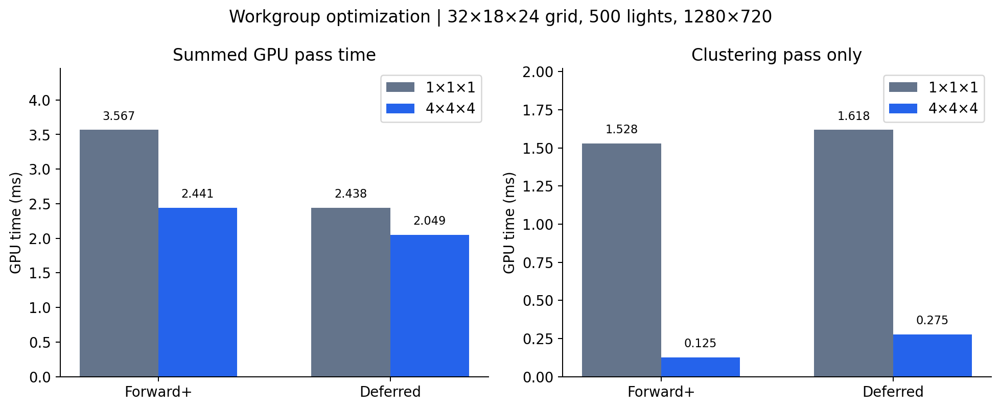

WebGL Forward+ and Clustered Deferred Shading
======================

**University of Pennsylvania, CIS 565: GPU Programming and Architecture, Project 4**

* Thomas Lee
* Tested on: (TODO) **Google Chrome 222.2** on
  Windows 11 Pro, AMD Ryzen 9 7845HX, 64 GB RAM, NVIDIA GeForce RTX 4070 Laptop GPU (8 GB). Personal laptop.

### Live Demo

### Demo Video/GIF

[]

### Introduction

This project implements naive forward shading, Forward+, and clustered deferred shading in WebGPU. I used the Sponza scene to compare how the three methods handle increasing numbers of point lights. The GUI lets us switch renderers and change the light count while viewing the scene.

For the performance analysis, I looked at the number of lights, the cluster grid size, and the clustering workgroup size. I saw that deferred was faster in most of my tests, but naive was still fastest with only one light. Another important finding was that some of the faster results at high light counts came from overflowing cluster lists, so I checked those separately before using the timings to compare the renderers.

### Implementation

**Naive Forward Shading**

The naive renderer draws the scene directly to the canvas. Each shaded fragment loops over every light and adds up its contribution. This is simple and avoids the extra passes needed by the other methods, but it also means that every fragment checks lights that might be nowhere near it.

**Forward+**

For Forward+, I divide the camera frustum into a 3D grid of clusters. A compute shader builds a view-space AABB for each cluster and checks which light spheres overlap it. I store the matching light indices and a count for each cluster. When shading a fragment, I use its screen position and view-space depth to find its cluster, then loop over that cluster's lights instead of the entire scene's light list.

I used logarithmic depth slices so the clusters are smaller near the camera and larger farther away. Each cluster has space for 500 lights in these tests. The clustering shader assigns one invocation to each cluster, and I later changed how those invocations are grouped into workgroups to improve performance.

**Clustered Deferred Shading**

The deferred renderer reuses the same clustering code, but splits drawing the scene and calculating lighting into two passes. First, I render the geometry into a G-buffer containing world position, normal, and albedo. Then I draw a fullscreen triangle, read those textures, and calculate lighting using the visible surface's cluster.

### Benchmarking Methodology

I used GPU timestamp queries to measure the individual passes. Each recording starts with a five second warmup, followed by ten seconds of collecting timings. I read the results back in a batch after the recording finishes. I repeated each configuration three times, and the tables and graphs show the average of those three runs.

| Renderer | Passes included in reported total |
| --- | --- |
| Naive | Forward rendering |
| Forward+ | Clustering + forward rendering |
| Clustered deferred | Clustering + G-buffer + fullscreen lighting |

The reported totals add together the GPU pass times listed above. They exclude CPU submission, browser scheduling, presentation, the separate light-animation pass, and timing readback, so they should not be interpreted as the full frame time. Very small differences are also hard to judge because the timestamps are quantized.

All tests use 1280x720 and the default camera at (-7, 2, 0) with yaw and pitch set to zero. I froze the lights at animation time zero so each configuration used the same light positions. The list capacity stayed at 500 lights per cluster.

For the light-count test, I used an 8x8x8 grid. For the grid comparison, I kept the scene at 500 lights. Both of these tests used 1x1x1 clustering workgroups. I tested the change to 4x4x4 separately, keeping the other settings fixed. The current implementation uses the optimized workgroup size with a 32x18x24 grid.

### Number of Lights

I first wanted to see how each renderer scales as more lights are added. The graph uses a logarithmic time axis so the clustered results are still readable next to naive rendering. The light counts are shown as equally spaced categories along the horizontal axis.

| Scene lights | Naive (ms) | Forward+ (ms) | Deferred (ms) | Cluster-list status |
| ---: | ---: | ---: | ---: | --- |
| 1 | 1.353 | 1.454 | 1.626 | No overflow possible |
| 10 | 1.947 | 1.920 | 1.749 | No overflow possible |
| 100 | 4.659 | 2.493 | 1.675 | No overflow possible |
| 500 | 26.153 | 6.711 | 2.276 | No overflow possible |
| 1,000 | 55.659 | 14.791 | 2.691 | Verified zero overflow |
| 2,500 | 148.568 | 25.981 | 4.804 | 53/512 clusters overflow |
| 5,000 | 304.027 | 32.127 | 6.190 | 126/512 clusters overflow |

With only one light, naive is the fastest at 1.353 ms. This makes sense because there is very little lighting work, so building clusters or writing a G-buffer adds overhead without saving much. At 10 lights, naive and Forward+ are still very close, so I would not read too much into their small difference.

As the light count increases, the naive renderer gets much slower. At 500 lights, it takes 26.153 ms, compared with 6.711 ms for Forward+ and 2.276 ms for deferred. Since there are only 500 lights total, none of the cluster lists can overflow in this comparison. 

Both clustered methods benefit from checking fewer lights per fragment. Deferred also waits until the geometry pass has resolved visibility before doing the lighting calculations. This can avoid lighting surfaces that are later covered by other geometry. Forward+ can already reject some hidden fragments through depth testing, though, and I did not measure overdraw separately, so it is only a possible explanation for part of the difference.

When testing higher light count results, I noticed a problem with "overflowing". At 2,500 and 5,000 lights, some clusters run out of space and omit lights. The busiest cluster needs 1,210 entries at 2,500 lights and 2,421 at 5,000, both well above my capacity of 500. I kept these results in the graph to show what the current implementation does, but they are not equal quality comparisons with naive. Part of the flatter clustered curves comes from leaving out lighting work. The 1,000 light test does fit, with a maximum of 480 entries.

### Cluster Grid Size

Next, I varied the grid size while keeping 500 scene lights and 500 entries per cluster. This avoids overflow and lets me compare the cost of building more clusters against the savings from having fewer lights in each list.

| Grid | Total clusters | Forward+ (ms) | Deferred (ms) |
| --- | ---: | ---: | ---: |
| 8×4×6 | 192 | 8.680 | 2.560 |
| 16×9×12 | 1,728 | 4.550 | 2.249 |
| 32×18×24 | 13,824 | 3.601 | 2.397 |
| 48×27×36 | 46,656 | 6.844 | 5.392 |

I expected smaller clusters to reduce lighting work, but the results show that increasing the grid size only helps up to a point. Forward+ is fastest at 32x18x24, while deferred is fastest at 16x9x12 among the grids tested here. These results use the original 1x1x1 workgroups, so the best grid could change after optimizing the clustering pass.

The pass breakdown helps explain why the largest grid gets slower. For Forward+, moving from 32x18x24 to 48x27x36 reduces rendering from 2.079 to 1.720 ms, but clustering increases from 1.522 to 5.124 ms. The smaller lists save some shading work, but not enough to recover the extra clustering cost. My compute shader checks every light against every cluster, so adding clusters also adds many more intersection tests.

Deferred shows a similar pattern. Its fullscreen lighting time drops from 1.762 ms with the smallest grid to 0.319 ms with the largest timed grid. However, clustering rises from 0.128 to 4.686 ms. At that point, clustering takes most of the measured time.

### Light-List Capacity and Overflow

After seeing the high-light-count curves flatten, I checked whether the fixed list capacity was affecting the results. I added a separate compute entry point that counts every light overlapping each cluster, even after the normal list would be full. This reports how many clusters overflow and how large the busiest list actually needs to be. I ran it separately so the diagnostic work would not be included in the rendering timings.

| Grid | Required capacity: 500 lights | 1,000 lights | 2,500 lights | 5,000 lights |
| --- | ---: | ---: | ---: | ---: |
| 8×4×6 | 277 | **571** | **1,397** | **2,787** |
| 16×9×12 | 181 | 372 | **929** | **1,830** |
| 32×18×24 | 128 | 243 | **610** | **1,215** |
| 48×27×36 | 110 | 206 | **509** | **1,005** |
| 64×36×48 | 101 | 185 | 462 | **906** |

The bold values exceed my capacity of 500. Finer grids reduce the maximum list size in this view, but even the finest grid still overflows at 5,000 lights. One useful result was that 1,000 lights fits every grid except 8x4x6. That is why I used 500 lights for the grid timing comparison instead.

Increasing capacity would restore the missing lights, but it also uses more memory and gives the lighting shaders more work to do. 

### Workgroup Size Optimization

For the optimization test, I changed the clustering shader from 1x1x1 to 4x4x4 workgroups. Each invocation still handles one cluster, but now 64 invocations are grouped into each workgroup. I also changed the dispatch counts to divide each grid dimension by four and round up. The bounds check handles the extra invocations at the edges.

I kept the grid at 32x18x24, with 500 lights, capacity 500, and resolution 1280x720 for both versions. The final comparison uses the same camera position and three recordings per configuration.

| Renderer | Total before (ms) | Total after (ms) | Total reduction | Clustering before (ms) | Clustering after (ms) |
| --- | ---: | ---: | ---: | ---: | ---: |
| Forward+ | 3.567 | 2.441 | **31.6%** | 1.528 | 0.125 |
| Deferred | 2.438 | 2.049 | **15.9%** | 1.618 | 0.275 |

This change helped both renderers. Forward+ went from 3.567 to 2.441 ms while deferred went from 2.438 to 2.049 ms. The largest change was in clustering itself, which dropped from 1.528 to 0.125 ms for Forward+ and from 1.618 to 0.275 ms for deferred.

Grouping more invocations together gives the GPU a better opportunity to use its parallel execution resources than launching workgroups with only one invocation. The results support that change for this implementation, but they do not mean that a larger workgroup will always be faster. I only compared 1 and 64 invocations per workgroup here.

I would expect this optimization to help most when clustering takes a large part of the total time. If rendering already dominates, reducing clustering has less effect on the total. Forward+ had the larger total improvement in this comparison, but I would need more workloads to find the best and worst cases more generally.

### Credits

- [Vite](https://vitejs.dev/)
- [loaders.gl](https://loaders.gl/)
- [dat.GUI](https://github.com/dataarts/dat.gui)
- [stats.js](https://github.com/mrdoob/stats.js)
- [wgpu-matrix](https://github.com/greggman/wgpu-matrix)
